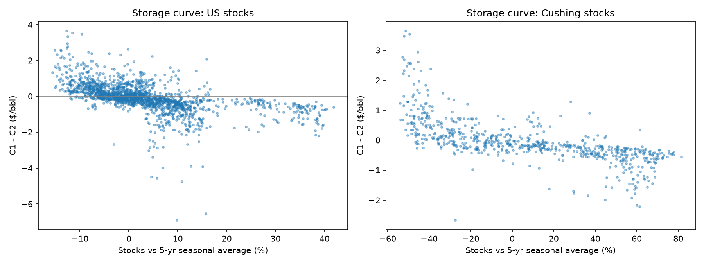

# Crude inventory surprise and the WTI calendar spread

Does the weekly EIA crude inventory number predict the WTI front calendar spread (C1 − C2) after it is published?

**Short answer: no.** Inventories explain the *level* of the spread very well (theory of storage holds), and the spread reacts on the release day, but there is no tradeable drift afterwards. A weekly strategy that fades inventory surprises loses money after costs.

## Idea

Theory of storage: when inventories are tight, prompt barrels carry a premium (backwardation, C1 > C2); when they are abundant, the curve moves into contango to pay for storage. If the market is slow to absorb a larger-than-normal build or draw, the spread should keep moving in the days after the report.

## Data

All from EIA, free, downloaded by the script.

| Series | Description | Sample |
|---|---|---|
| `WCESTUS1` | US commercial crude stocks ex-SPR, weekly | 1982– |
| `W_EPC0_SAX_YCUOK_MBBL` | Cushing, OK crude stocks, weekly | 2004– |
| `RCLC1`, `RCLC2` | NYMEX WTI futures, contracts 1 and 2, daily | 1983 – Apr 2024 |

EIA stopped updating the futures series in April 2024, so the tests end there.

## Method

- **Surprise**: weekly stock change minus the average change in the same week (±1) of the prior 5 years, scaled by its trailing 104-week standard deviation (`z`). Only information available at the release is used.
- **Level deviation**: stocks relative to the prior-5-year average for the same week.
- **Timing**: positions are entered at the close of the release day (Wednesday; Thursday when a federal holiday falls Monday–Wednesday).
- **Rolls**: any window that contains a contract expiry is dropped, since the change in a continuous C1 − C2 series across a roll is not a P&L.
- **Inference**: OLS with Newey–West standard errors; split at 2016-01-01.
- **Backtest**: each week take position −z (capped at ±2) in the spread, hold 5 trading days, 2 ticks round-trip cost. April 2020 excluded.

## Results

**1. Storage curve (spread level on inventory level deviation)**

| Stocks | Slope ($/bbl per 1%) | t | R² | n |
|---|---|---|---|---|
| US | −0.042 | −8.6 | 0.30 | 1,793 |
| Cushing | −0.013 | −7.3 | 0.47 | 670 |



The relationship is strong and convex: the spread explodes upward when Cushing is far below normal and flattens out at storage cost when it is full.

**2. Release-day reaction (spread change on z)**

| Stocks | Slope | t | R² |
|---|---|---|---|
| US | −0.017 | −2.9 | 0.010 |
| Cushing | −0.008 | −1.8 | 0.007 |

Right sign, small. The seasonal-norm surprise is a noisy proxy for what the market actually expected.

**3. Post-release drift (5-day spread change on z)**

| Stocks | Sample | Slope | t | n |
|---|---|---|---|---|
| US | full | −0.009 | −0.9 | 1,147 |
| US | pre-2016 | −0.010 | −0.8 | 868 |
| US | 2016– | −0.008 | −0.5 | 279 |
| Cushing | full | +0.014 | +1.1 | 440 |

Nothing at 1, 3, 5 or 10 days in either series (full table in `results.txt`). The only |t| > 2 is the US 1-day drift before 2016, which flips sign afterwards.

**4. Backtest (annualised Sharpe)**

| Stocks | Sample | Gross | Net |
|---|---|---|---|
| US | full | +0.16 | −0.10 |
| US | 2016– | +0.06 | −0.27 |
| Cushing | full | −0.31 | −0.69 |


The US gross P&L is dominated by a handful of weeks in the early-2009 super-contango; outside those it is flat.

## Limitations

- The surprise is measured against a seasonal norm, not the analyst consensus or the API number published the evening before. The market's true surprise is smaller and different.
- Revised inventory data are used, not first-print vintages.
- Daily closes only: any reaction within minutes of 10:30 ET is invisible here.
- Expiry dates come from the contract rule and a US holiday calendar, with a one-day safety margin.

## Next steps

- Use consensus forecasts to build a true surprise.
- Trade the level, not the change: the storage curve fits well, so test whether deviations of the spread from the curve-implied value mean-revert.
- Product inventories against crack spreads (gasoline, distillate), where fewer participants watch the numbers.
- Condition on regime: surprises may matter more when Cushing is near tank bottoms or tank tops, where the curve is steepest.

## Run

```
pip install pandas statsmodels xlrd matplotlib
python inventory_surprise.py             # real data
python inventory_surprise.py --selftest  # synthetic data with a planted effect
```
