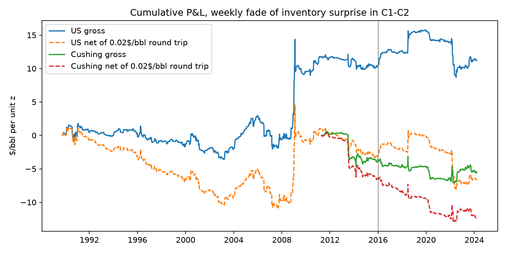
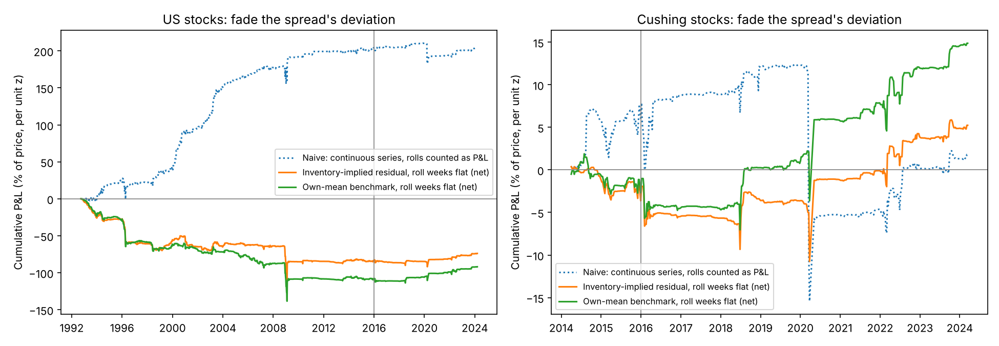

# Crude inventory surprise and the WTI calendar spread

Does the weekly EIA crude inventory number predict the WTI front calendar spread (C1 − C2) after it is published?

**Short answer: no.** Inventories explain the *level* of the spread very well (theory of storage holds), and the spread reacts on the release day, but there is no tradeable drift afterwards. A weekly strategy that fades inventory surprises loses money after costs.

A follow-up test asks whether the spread reverts to its inventory-implied level. In the continuous C1 − C2 series it appears to, but **all of that reversion occurs in weeks that contain a contract roll**. A backtest that ignores this shows a Sharpe of +0.55; handled properly it is −0.10.

## Idea

Theory of storage: when inventories are tight, prompt barrels carry a premium (backwardation, C1 > C2); when they are abundant, the curve moves into contango to pay for storage. If the market is slow to absorb a larger-than-normal build or draw, the spread should keep moving in the days after the report.

## Data

All from EIA, free, downloaded by the script.

| Series | Description | Sample |
|---|---|---|
| `WCESTUS1` | US commercial crude stocks ex-SPR, weekly | 1982– |
| `W_EPC0_SAX_YCUOK_MBBL` | Cushing, OK crude stocks, weekly | 2004– |
| `RCLC1`, `RCLC2` | NYMEX WTI futures, contracts 1 and 2, daily | 1983 – Apr 2024 |

EIA stopped updating the futures series in April 2024, so the tests end there.

## Method

- **Surprise**: weekly stock change minus the average change in the same week (±1) of the prior 5 years, scaled by its trailing 104-week standard deviation (`z`). Only information available at the release is used.
- **Level deviation**: stocks relative to the prior-5-year average for the same week.
- **Timing**: positions are entered at the close of the release day (Wednesday; Thursday when a federal holiday falls Monday–Wednesday).
- **Rolls**: any window that contains a contract expiry is dropped, since the change in a continuous C1 − C2 series across a roll is not a P&L.
- **Inference**: OLS with Newey–West standard errors; split at 2016-01-01.
- **Backtest**: each week take position −z (capped at ±2) in the spread, hold 5 trading days, 2 ticks round-trip cost. April 2020 excluded.

## Results

**1. Storage curve (spread level on inventory level deviation)**

| Stocks | Slope ($/bbl per 1%) | t | R² | n |
|---|---|---|---|---|
| US | −0.042 | −8.6 | 0.30 | 1,793 |
| Cushing | −0.013 | −7.3 | 0.47 | 670 |


The relationship is strong and convex: the spread explodes upward when Cushing is far below normal and flattens out at storage cost when it is full.

**2. Release-day reaction (spread change on z)**

| Stocks | Slope | t | R² |
|---|---|---|---|
| US | −0.017 | −2.9 | 0.010 |
| Cushing | −0.008 | −1.8 | 0.007 |

Right sign, small. The seasonal-norm surprise is a noisy proxy for what the market actually expected.

**3. Post-release drift (5-day spread change on z)**

| Stocks | Sample | Slope | t | n |
|---|---|---|---|---|
| US | full | −0.009 | −0.9 | 1,147 |
| US | pre-2016 | −0.010 | −0.8 | 868 |
| US | 2016– | −0.008 | −0.5 | 279 |
| Cushing | full | +0.014 | +1.1 | 440 |

Nothing at 1, 3, 5 or 10 days in either series (full table in `results.txt`). The only |t| > 2 is the US 1-day drift before 2016, which flips sign afterwards.

**4. Backtest (annualised Sharpe)**

| Stocks | Sample | Gross | Net |
|---|---|---|---|
| US | full | +0.16 | −0.10 |
| US | 2016– | +0.06 | −0.27 |
| Cushing | full | −0.31 | −0.69 |



The US gross P&L is dominated by a handful of weeks in the early-2009 super-contango; outside those it is flat.

## Extension: reversion to the inventory-implied level

`storage_curve_reversion.py`. Since the storage curve fits well, the natural trade is on the level: fit spread (as % of price) on the inventory deviation using past data only, and fade the residual. The benchmark is the same trade without inventories (spread minus its own trailing mean). Four curve specifications (linear or quadratic, expanding or rolling 5-year window) were fixed in advance and all are in `results_reversion.txt`; the numbers below are quadratic, rolling, and the others agree.

**No reversion within a contract pair.** 5-day spread change on the residual z-score, roll windows dropped:

| Stocks | Slope | t | n |
|---|---|---|---|
| US | +0.024 | +0.5 | 1,046 |
| Cushing | −0.001 | −0.0 | 339 |

At 10 days the US slope is positive (t = +2.2), i.e. deviations extend. That comes from two episodes, late 2008 and March 2020, when storage filled and contango kept widening; outside them it is +0.05 (t = +1.0). The inventory residual does not beat the own-mean benchmark in any specification.

**The reversion in the continuous series is a roll effect.** Week-to-week change in the continuous C1 − C2 level on the residual z-score, crises excluded:

| Stocks | Weeks | Slope | t | n |
|---|---|---|---|---|
| US | no roll | +0.000 | +0.0 | 980 |
| US | roll | −0.303 | −5.2 | 558 |
| Cushing | no roll | −0.038 | −1.7 | 307 |
| Cushing | roll | −0.083 | −1.5 | 160 |



| US stocks, gross Sharpe | Full | Pre-2016 | 2016– |
|---|---|---|---|
| Naive (rolls counted as P&L) | +0.55 | +0.70 | −0.00 |
| Roll weeks flat | −0.10 | −0.20 | +0.41 |

A dislocated front spread is replaced by the next, less dislocated contract pair rather than converging. With only C1 and C2 I cannot tell how much of the roll-week move is the mechanical contract switch and how much is genuine convergence in the last days before expiry; that needs contract-level prices.

## Limitations

- The surprise is measured against a seasonal norm, not the analyst consensus or the API number published the evening before. The market's true surprise is smaller and different.
- Revised inventory data are used, not first-print vintages.
- Daily closes only: any reaction within minutes of 10:30 ET is invisible here.
- Expiry dates come from the contract rule and a US holiday calendar, with a one-day safety margin.
- Roll windows are dropped rather than traded, so any real P&L in the days before expiry is not measured.

## Next steps

- Contract-level prices (or C3/C4) to build a roll-adjusted spread P&L and separate pre-expiry convergence from the contract switch.
- Use consensus forecasts to build a true surprise.
- Product inventories against crack spreads (gasoline, distillate), where fewer participants watch the numbers.
- Condition on regime: the 2008 and 2020 episodes suggest that near tank tops the right trade is with the dislocation, not against it.

## Run

```
pip install pandas statsmodels xlrd matplotlib
python inventory_surprise.py             # downloads data, runs the surprise tests
python inventory_surprise.py --selftest  # synthetic data with a planted effect
python storage_curve_reversion.py        # extension, uses ./data
```
